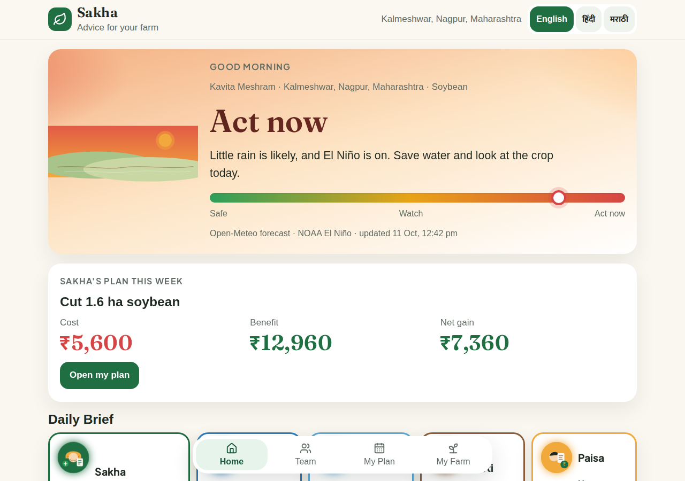
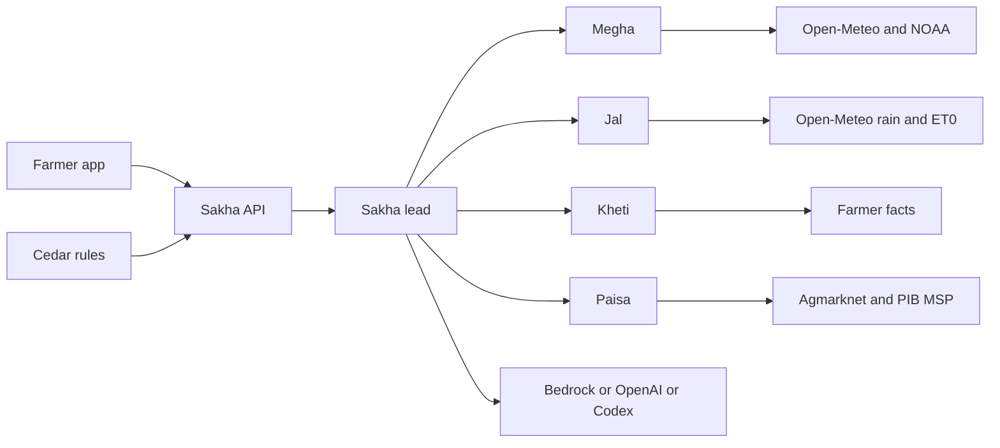

# Sakha



One farm team for an Indian smallholder: Sakha leads Megha, Jal, Kheti and Paisa, and every number on the screen has a source.

## The team

| Teammate | Lane | What you see |
| --- | --- | --- |
| Sakha | Lead | One plan for the week, after the others have spoken |
| Megha | Weather | Open-Meteo rain and the NOAA El Niño number |
| Jal | Water | Irrigate or wait, from rain and evaporation |
| Kheti | Crop | Stage from the sowing date the farmer reported |
| Paisa | Money | Mandi modal, MSP, and the rupee gap |

## Architecture

Sakha is the only lead. In the [Strands Agents](https://strandsagents.com/) runtime each teammate is a tool Sakha can call. [Cedar](https://www.cedarpolicy.com/) rules refuse a teammate who steps into another lane (Megha cannot read the mandi; Paisa can). Adapters return `{ data, source, fetched_at }` and fall back to the committed JSON cache. The words can come from Amazon Bedrock, OpenAI, or Codex. The seeded demo does not need a key.



## Quickstart

Node.js 24 and pnpm 12.10.1, as in `package.json`.

```sh
pnpm install
cp .env.example .env
pnpm seed:demo
pnpm dev
pnpm eval:agents
```

Open http://127.0.0.1:5173. The API is on http://127.0.0.1:4310. `pnpm seed:demo` writes `.local/demo/sakha.sqlite` and `pnpm dev` opens that file. Saved chats for Kavita Meshram of Kalmeshwar are on screen with no model key. Set `SAKHA_SEED_LIVE=0` to skip the network and use only `packages/data/cache`.

For live wording, fill `.env` and restart `pnpm dev`:

- Strands on OpenAI: `OPENAI_API_KEY` and `SAKHA_OPENAI_MODEL`
- Strands on Amazon Bedrock: `SAKHA_STRANDS_PROVIDER=bedrock`, `SAKHA_BEDROCK_MODEL_ID`, `AWS_REGION`, and AWS credentials or `SAKHA_BEDROCK_API_KEY`
- Codex: `SAKHA_CODEX_ENABLED=true` with an existing Codex login (`SAKHA_CODEX_MODEL` defaults to `gpt-6-luna`)

A live Agmarknet pull also needs `DATA_GOV_IN_API_KEY`. Without it, prices stay on the committed cache.

## Data sources

| Reading in the demo | Source |
| --- | --- |
| 7-day rain and evaporation | [Open-Meteo forecast](https://open-meteo.com/) for 21.15 N, 79.1 E |
| Season rain | [Open-Meteo archive](https://open-meteo.com/) and [NASA POWER](https://power.larc.nasa.gov/) |
| El Niño, JAS 2026 ONI +2.16 °C | Committed copy of [NOAA CPC ONI](https://www.cpc.ncep.noaa.gov/data/indices/oni.ascii.txt) |
| Nagpur soyabean modal ₹6,175/qtl, 7 Oct 2026 | [data.gov.in Agmarknet resource](https://api.data.gov.in/resource/9ef84268-d588-465a-a308-a864a43d0070), cached after the live call did not complete |
| Soybean (Yellow) MSP ₹5,708 | [PIB release](https://www.pib.gov.in/PressReleasePage.aspx?PRID=2260618), 13 May 2026 |

Harvest labour ₹5,600 and the 19.2 quintal expectation are the farmer's own figures. The ₹12,960 benefit is the cached modal-minus-minimum gap on those quintals, not a promised sale.

## Tests and eval

```sh
pnpm typecheck
pnpm test
pnpm eval:agents
pnpm build
pnpm test:browser
```

`pnpm test` is Vitest. `pnpm eval:agents` runs the mock prompt suite: routing, the call caps, and Cedar's allow and deny checks, with no model call. `pnpm test:browser` is the Playwright pass against a local server. `pnpm test:demo` runs that same suite.

## AI tool disclosure

- Cursor cloud agents, using Grok, for the integration and this polish pass.
- **Owner: write your other tools here before you submit.**

## Attribution

- Team pattern and optional model path: [Strands Agents](https://strandsagents.com/). Policy checks: [Cedar](https://www.cedarpolicy.com/) (`policies/sakha-v1.cedar`).
- Weather, climate and prices: Open-Meteo (CC BY 4.0), NOAA CPC (US public data), NASA POWER, data.gov.in / Agmarknet, and the Press Information Bureau. Cache notes live in `packages/data/cache/`.
- UI type: [Noto Sans and Noto Sans Devanagari](https://fonts.google.com/noto) (SIL Open Font License), shipped under `apps/web/public/fonts/`.
- App libraries include React, Vite, Fastify, better-sqlite3, Zod, Radix, and Lucide. See the lockfile for versions.
